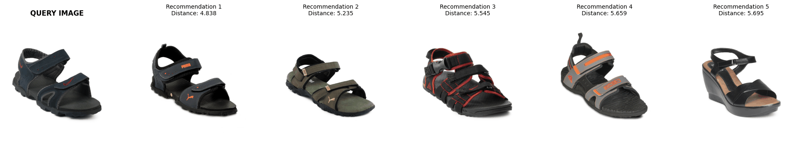
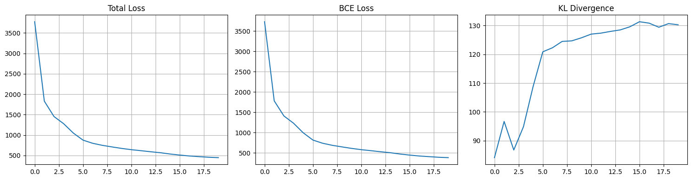

# PyTorch Deep Learning

Deep learning projects implemented from scratch in **PyTorch**, from a classic convolutional network for handwritten digit recognition to a **Variational Autoencoder (VAE)** that powers a visual fashion recommendation system.

| Notebook | Task | Model | Dataset | Result |
|---|---|---|---|---|
| [`CNN.ipynb`](CNN.ipynb) | Image classification | LeNet-style CNN | MNIST | **98.57%** test accuracy |
| [`fashion-vae-recommender.ipynb`](fashion-vae-recommender.ipynb) | Content-based recommendation | Convolutional VAE + k-NN | Fashion Product Images | Visually similar product retrieval |

---

## 1. Fashion recommender with a Variational Autoencoder

A **content-based recommendation system** that finds visually similar fashion products using only their images, with no labels, purchase history or metadata. A convolutional VAE learns a compact **128-dimensional latent representation** of each product image; similar items are then retrieved with **nearest-neighbour search** in that latent space.

<p align="center">
  
</p>

### How it works

```
 Product image ──► Encoder (CNN) ──► μ, log σ²  ──► latent vector z (128-d)
   64×64×3                                               │
                                                         ├──► Decoder ──► reconstruction (training)
                                                         │
                                                         └──► k-NN index ──► top-5 similar products
```

1. **Train** a VAE to reconstruct product images. The KL term forces the latent space to be smooth, so visually similar images end up close together.
2. **Encode** every image in the catalogue and store its mean vector μ as its embedding.
3. **Index** the embeddings with scikit-learn `NearestNeighbors` (Euclidean distance).
4. **Recommend**: for a query product, return its 5 nearest neighbours, excluding the item itself.

### Model architecture

| Part | Layers | Shape |
|---|---|---|
| Encoder | 4 × `Conv2d(k=4, s=2, p=1)` + ReLU, channels 32 → 64 → 128 → 256 | 3×64×64 → 256×4×4 |
| Latent | Two linear heads for μ and log σ², **reparameterization trick** z = μ + σ·ε | 4096 → 128 |
| Decoder | Linear projection, then 4 × `ConvTranspose2d(k=4, s=2, p=1)` + ReLU, **Tanh** output | 128 → 3×64×64 |

**2,957,251** trainable parameters.

### Training

| Setting | Value |
|---|---|
| Loss | MSE reconstruction (sum) + β · KL divergence, **β = 0.5** |
| Optimizer | AdamW, learning rate 1e-3, weight decay 1e-5 |
| Batch size / epochs | 128 / 20 |
| Preprocessing | Resize to 64×64, normalize to [-1, 1] to match the Tanh output |
| Data | A 5,000-image subset of the 44,441 product images |
| Hardware | Kaggle, NVIDIA Tesla P100 (16 GB), PyTorch 2.6 |
| Checkpoints | Every 5 epochs, plus the final model |

<p align="center">
  
</p>

The average loss per image drops from **3,773 to 448** over 20 epochs. Reconstruction error falls steadily while the KL term rises and levels off around 130, showing the encoder making increasing use of the latent space.

### Running it

The notebook is written for **Kaggle**:

1. Create a Kaggle notebook and add the [Fashion Product Images Dataset](https://www.kaggle.com/datasets/paramaggarwal/fashion-product-images-dataset) as input.
2. Turn on a **GPU accelerator**.
3. Run all cells. Outputs go to `/kaggle/working/`:
   - `models/vae_epoch_{5,10,15,20}.pth`, `models/vae_final.pth`: model weights
   - `models/recommender.pkl`: latent vectors and image names
   - `results/training_history.png`, `results/recommendation_{1,2,3}.png`

To run it elsewhere, change `DATASET_INPUT_PATH` and `WORKING_DIR` in the paths cell. Raise or remove `max_images=5000` to train on the full catalogue.

---

## 2. CNN for handwritten digit recognition (MNIST)

A LeNet-style convolutional network built step by step. The notebook first passes a single image through each layer by hand to show how the tensor shape changes, then wraps everything into a model class.

### Architecture

| Layer | Configuration | Output shape |
|---|---|---|
| Input | Grayscale image | 1 × 28 × 28 |
| Conv 1 + ReLU | 6 filters, 3×3, stride 1 | 6 × 26 × 26 |
| Max pool | 2×2, stride 2 | 6 × 13 × 13 |
| Conv 2 + ReLU | 16 filters, 3×3, stride 1 | 16 × 11 × 11 |
| Max pool | 2×2, stride 2 | 16 × 5 × 5 |
| FC 1 + ReLU | 400 → 120 | 120 |
| FC 2 + ReLU | 120 → 84 | 84 |
| FC 3 | 84 → 10, log-softmax | 10 |

**60,074** trainable parameters.

### Training and results

| Setting | Value |
|---|---|
| Data | 60,000 training / 10,000 test images |
| Batch size / epochs | 10 / 5 |
| Optimizer | Adam, learning rate 0.001 |
| Loss | Cross-entropy |
| Seed | `torch.manual_seed(41)` |
| Training time | ≈11 minutes on CPU (Google Colab) |
| **Test accuracy** | **98.57%** (9,857 / 10,000) |

The notebook ends with single-image inference: the model predicts a held-out test digit and the result is shown next to the image.

### Running it

Open it directly in Colab with the badge at the top of the notebook, or run it locally. MNIST is downloaded automatically by `torchvision`.

---

## Setup

```bash
git clone https://github.com/eceakin/PyTorch-DeepLearning.git
cd PyTorch-DeepLearning

pip install torch torchvision numpy pandas matplotlib seaborn scikit-learn pillow tqdm jupyter
jupyter notebook
```

For a CUDA build of PyTorch, use the command for your platform from [pytorch.org](https://pytorch.org/get-started/locally/).

## Tech stack

PyTorch · torchvision · scikit-learn · NumPy · pandas · Matplotlib · seaborn · Pillow · Jupyter, Google Colab and Kaggle

## References

- D. P. Kingma and M. Welling, "Auto-Encoding Variational Bayes," *ICLR*, 2014.
- Y. LeCun, L. Bottou, Y. Bengio and P. Haffner, "Gradient-based learning applied to document recognition," *Proceedings of the IEEE*, 1998.
- P. Aggarwal, [Fashion Product Images Dataset](https://www.kaggle.com/datasets/paramaggarwal/fashion-product-images-dataset), Kaggle.
